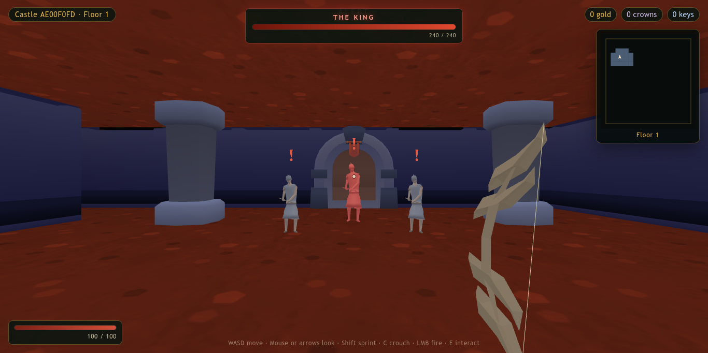

# GreenHood 64



A first-person Robin Hood stealth-archer dungeon crawler built with **Babylon.js**, **TypeScript**, **Vite** and **pnpm**. Raid a generated two-floor castle, loot chests and vaults, defeat the king, and extract back to Sherwood to spend gold and crowns on upgrades.

## Controls

| Action | Key |
| --- | --- |
| Move | `W` `A` `S` `D` |
| Look | Mouse or arrow keys |
| Sprint | `Shift` |
| Crouch | `C` |
| Charge / fire bow | Hold / release `LMB` |
| Takedown guard | `E` while crouched behind an unaware guard |
| Interact / shop / enter castle | `E` |
| Pause / recapture mouse | `Esc` (or click) |

## Run it

Requirements:

- Node.js >= 20.19
- pnpm 11
- Optional: Blender, only to regenerate the custom models

```bash
pnpm install
pnpm assets:prepare   # copy Kenney GLBs/textures from Assets/ into public/assets/
pnpm dev
```

Open the printed URL.

Optional model re-export:

```bash
pnpm assets:models
```

## Current state

- **Sherwood camp:** fixed forest hub with a castle keep, gate, and four merchant stalls (Bows, Abilities, Training, Crowns).
- **Castle runs:** generated two-floor layouts with rooms, corridors, walkable stairs, chests, keys, vaults, and a fog-of-war minimap.
- **Combat:** charged physical arrows, nocked draw animation, arrows that stick in guards and walls, guard vision/hearing/alerts, patrol/chase/search AI, player health and death, and crouched takedowns.
- **King encounter:** the king and bodyguards occupy the upper-floor chamber; killing him pays crowns.
- **Progression:** gold and crowns persist in `localStorage`; bow tiers, abilities, and training are purchased at the camp.
- **QoL:** key counter, locked chests with gold auras, chest collision, smaller dungeon layouts, minimap with floor markers, and stair direction indicators.

## Debug and dev tools

| URL / command | Purpose |
| --- | --- |
| `?debug=1` | Debug HUD (seed, position, state, FPS, combat) |
| `?view=assets` | Asset viewer for every kit and custom model |
| `?castle=1` | Start directly in a castle run |
| `?castle=1&at=vault` | Spawn inside the vault |
| `?castle=1&at=guard` | Spawn near the first guard |
| `/combat` or `?view=combat` | Combat test arena with a respawning guard |
| `?god` | Disable player damage |
| `scripts/shot.sh <url> <out.png>` | Headless screenshot helper |
| `scripts/eval.sh <url> <js>` | Evaluate JS in the running page |

## Scripts

| Script | Purpose |
| --- | --- |
| `pnpm dev` | Vite dev server |
| `pnpm build` | Type-check and production build in `dist/` |
| `pnpm preview` | Serve the production build |
| `pnpm test` | Vitest logic tests |
| `pnpm typecheck` | TypeScript only |
| `pnpm assets:prepare` | Copy runtime assets into `public/assets/` |
| `pnpm assets:models` | Re-export the custom guard, bow, and arrow models with Blender |

## Project layout

```
src/
  app/      application state, save data
  core/     engine-independent logic (rng, collision, dungeon gen, combat, shop)
  world/    Babylon scene builders (hub, castle, skybox) and asset loading
  gameplay/ player controller, combat, guards, arrows, bow viewmodel
  ui/       HTML/CSS overlays (HUD, shop, minimap)
scripts/    asset preparation, Blender exports, headless dev helpers
tests/      Vitest logic tests
docs/       README screenshots
```

## Source assets

The reference art lives in `Assets/Models/` and is never modified. `pnpm assets:prepare` copies the runtime Kenney assets into `public/assets/kenney/`; the Blender script writes generated models into `public/assets/custom/`.

- **Kenney** — Fantasy Town Kit, Mini Dungeon, Modular Dungeon Kit (CC0)
- **CptDrunkBear** — `items.blend` bow meshes (public domain)
- **Mujtaba-io** — `soldier-20.blend` guard (public domain)
- **Umplix** — `arrow.blend` arrow mesh (public domain)

See `CREDITS.md` for links.
